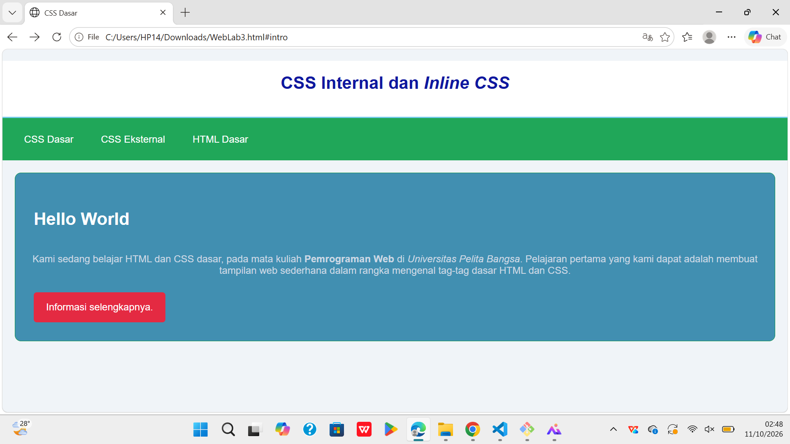
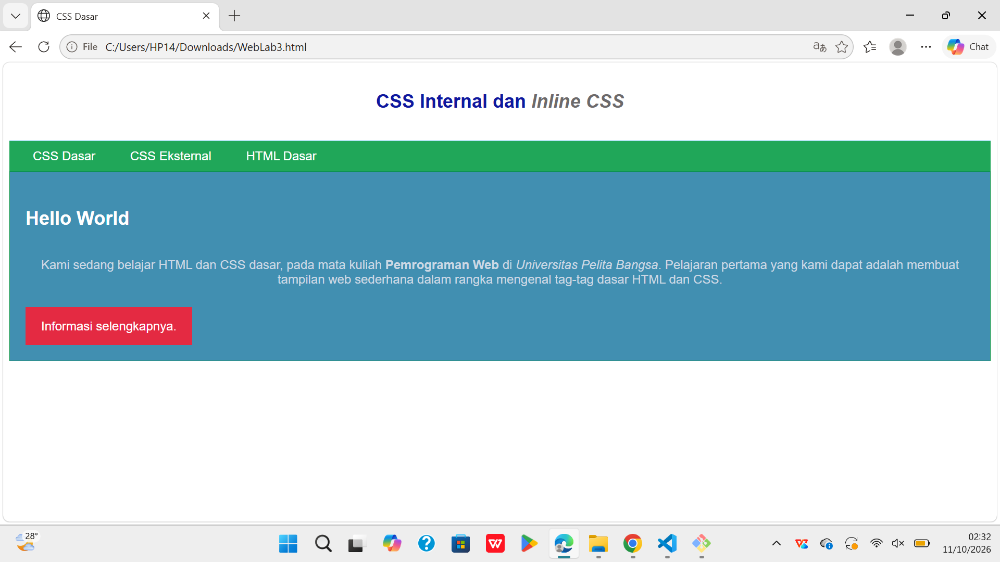
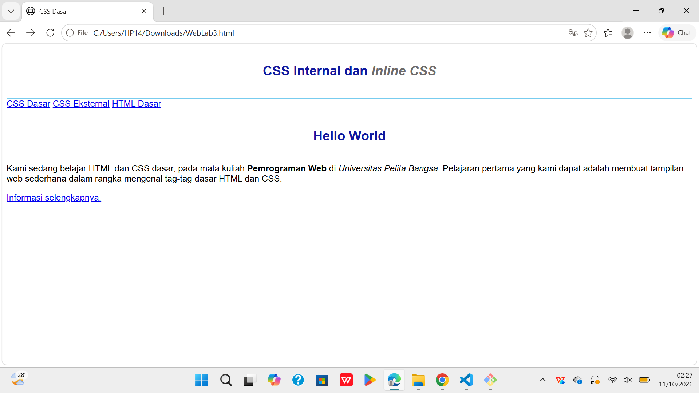
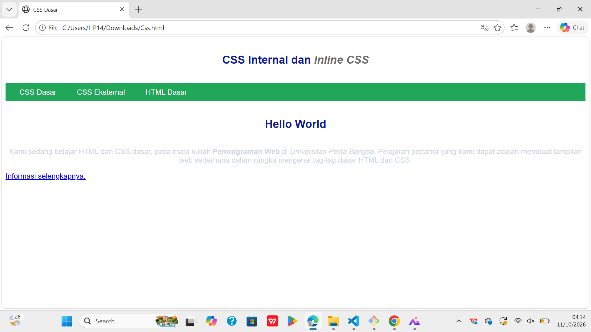
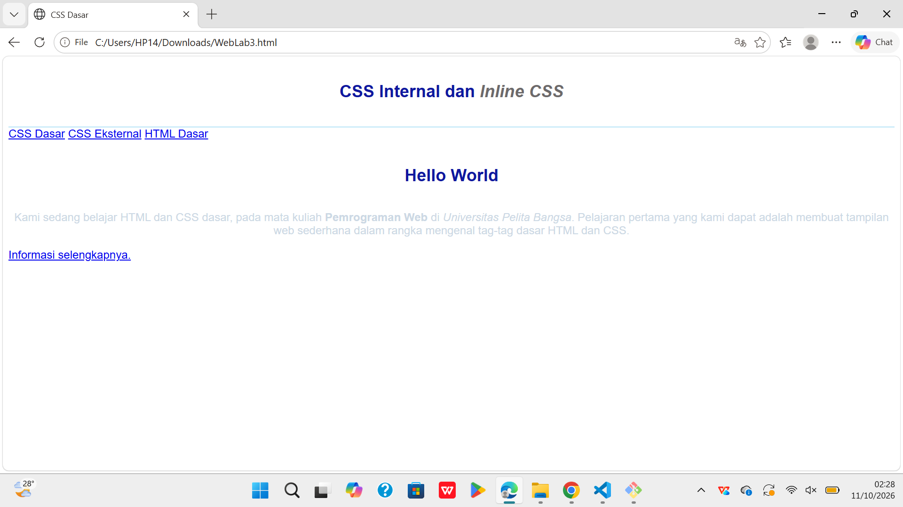

# WebLab3

## Nama: Fahrul Rahman

## Nim: 312510088

### 1. Lakukan eksperimen dengan mengubah dan menambah properti dan nilai pada kode CSS dengan mengacu pada CSS Cheat Sheet yang diberikan pada file terpisah dari modul ini

Penjelasan:
Beberapa properti CSS yang diubah atau ditambahkan adalah:

- background-color digunakan untuk mengubah warna latar belakang halaman web.
- font-size digunakan untuk mengatur ukuran tulisan agar lebih besar atau lebih kecil.
- color digunakan untuk mengubah warna teks.
- margin digunakan untuk mengatur jarak di luar elemen.
- padding digunakan untuk mengatur jarak antara isi elemen dan batasnya.
- border-radius digunakan untuk membuat sudut elemen menjadi melengkung.
- :hover digunakan untuk mengubah tampilan elemen ketika kursor diarahkan ke elemen tersebut.
  Contohnya, pada bagian #intro, properti background dapat diubah menjadi warna lain, kemudian ditambahkan border-radius: 10px agar sudut kotak menjadi melengkung.
  Kesimpulan:
  Berdasarkan eksperimen yang dilakukan, perubahan dan penambahan properti CSS dapat memengaruhi tampilan halaman web, seperti warna, ukuran teks, jarak antar-elemen, dan bentuk kotak. Dengan menggunakan CSS, halaman web dapat dibuat lebih menarik, rapi, dan mudah dibaca.

#### 2. Apa perbedaan pendeklarasian CSS elemen h1 {...} dengan #intro h1 {...}? berikan penjelasannya!

Penjelasan:
Selector h1 berlaku untuk semua elemen judul h1>, sedangkan selector #intro h1 hanya berlaku untuk elemen h1> yang berada di dalam elemen dengan ID intro. Selector #intro h1 lebih spesifik sehingga aturan tersebut akan diutamakan ketika kedua selector mengatur properti yang sama dan memiliki tingkat kepentingan yang sama.

##### 3. Apabila ada deklarasi CSS secara internal, lalu ditambahkan CSS eksternal dan inline CSS pada elemen yang sama. Deklarasi manakah yang akan ditampilkan pada browser? Berikan penjelasan dan contohnya!

Internal

Eksternal

Inline

contoh

Penjelasan:
CSS internal, eksternal, dan inline memiliki aturan prioritas masing-masing. Inline CSS umumnya lebih diprioritaskan jika ketiganya mengatur properti yang sama. Namun, hasil akhir juga dapat dipengaruhi oleh spesifisitas selector, urutan deklarasi, dan penggunaan !important.
